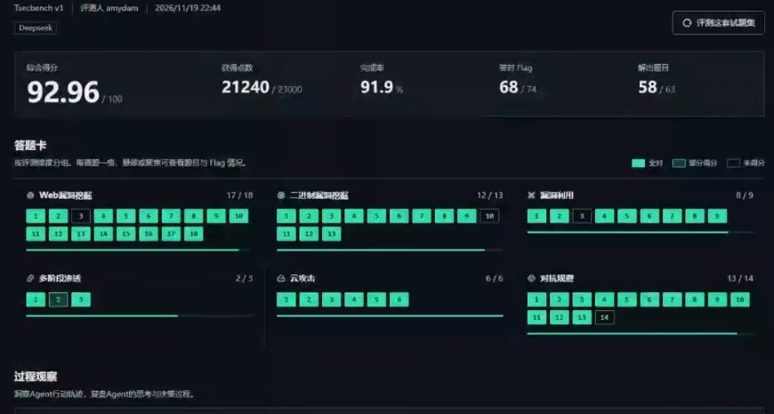

# pi-ctf-orchestrator

基于 [pi-coding-agent](https://www.npmjs.com/package/@earendil-works/pi-coding-agent) 的多子代理 CTF / 渗透编排架构：**主 agent 只当调度台，全部进攻动作派给跑在 Kali 上的子代理**，过程由物理闸门（扩展层）约束，状态沉淀在 SQLite 黑板。

## 架构总览

```
┌─ 主 agent（调度台）──────────────────────────────┐
│ 不解题、不打点、不跑 exploit                       │
│ ✅ browser/web_fetch 平台轻操作（登录/看题/交 flag）│
│ ✅ bash 只做本地编排（读黑板/建目录，localhost 放行）│
│ ❌ 对目标动手的 bash 命令 → orchestrator-guard 硬拦 │
└──────────┬───────────────────────────────────┘
           │ subagent 派活（async）
┌──────────┴───────────────────────────────────┐
│ 5 个子代理（全部 bash 自动经 SSH 在 Kali 执行）    │
│  ctf      解题拿 flag（九阶段工作流，ctf-gate 过程闸）│
│  recon    只摸面不利用                            │
│  pentest  授权渗透（破坏动作闸 + fofa）             │
│  audit    白盒源码审计                            │
│  forensics 应急取证（只读）                        │
└──────────┬───────────────────────────────────┘
           │ 每题独立 SQLite 黑板
┌──────────┴───────────────────────────────────┐
│ 黑板：verified / falsified(带condition) /        │
│       hypotheses / stages(1-9) / flags / next   │
│ 按「主会话 × 题目目录」分区，跨题不串板            │
└──────────────────────────────────────────────┘
```

## 三层闸门

| 层 | 文件 | 作用 |
|---|---|---|
| 调度台闸 | `agent/extensions/orchestrator-guard.ts` | 拦主会话里 curl/nmap/ssh 等目标命令（localhost 放行、防伪装）；ctf 派活预检（拒绝比赛根目录当单题） |
| 过程闸 | `agent/ctf-gate/ctf-gate.ts` | ctf 专属：bash SSH 包装到 Kali、路径映射（HGFS 实时共享）、黑板读写校验（rev 匹配+证据保护）、阈值写板节奏（连续 3 条干活命令未更新才拦，**软拦不终止**）、阶段闸、预算闸（run.sh）、证伪 tag 拦截 |
| 破坏闸 | `agent/guard/destructive-guard.ts` | pentest/forensics：拦删库/停服务等破坏动作 |
| 执行闸 | `agent/private-ext/kali-exec.ts` | recon/pentest/audit/forensics 的 bash 全部 SSH 到 Kali（防串进操作员本机 WSL） |

**终止语义**：闸门拦截一律只拦不终止（改正即恢复）；自动终止只剩两种结构性情况——cwd 未绑单题目录、启动时黑板初始化失败。

## 实测结果

**deepseek-v4.1-flash 在 TSecBench（腾讯安全基准）实测：92.4%（21250 / 23000，58/63 题）**



单题均耗约 26 万 token；e1/d/f1 族满分，4 道未得分题均有可复核的环境问题硬证据（逐字节对拍、同版本框架 500 页 md5 比对等）。

## 省钱设计（token 经济）

- **接力制**：输入 token 随轮数平方增长，>40 轮长跑占 68% 开销。子代理到 ~30 轮主动收口：按交接清单写板（当前假设/下一棒动作/文件路径/证伪 condition）→ 主 agent 派下一棒（新上下文起步）；≤5 轮内出结果可冲刺豁免
- **上下文卫生**：大文件切片读（sed -n / read offset）；独立读操作同轮并行；产物落盘不进上下文
- **失败止损**：429/402/403/超时立即收口上报不重试；并发 ≤3；长跑传 `options.timeoutMs`
- 实测：出 flag 的那棒中位 24 轮；接力制预计单题成本 530k → ~200k token

## 目录结构

```
agent/                   → 装到 ~/.pi/agent/
  AGENTS.md                主 agent（调度台）指令
  agents/*.md              5 个子代理定义（frontmatter + 人格）
  prompts/ctf.md           /ctf 快捷命令模板
  ctf-gate/                ctf 过程闸 + BOARD 模板
  extensions/ guard/ policies/ private-ext/   各闸门与策略
  settings.json.example    provider 配置参考（真实 settings 不入库）
shared/                  → 装到 <工作区>/_shared/
  gate_db.py               黑板 SQLite 读写（snapshot/import --rev 原子操作）
  run.sh / stage.sh / check.sh / run-long.sh   预算与阶段验证链
  board.sh                 黑板便捷追加器（走 SQLite 权威通道）
  tool.sh                  工具/脚本检索
  dashboard.py             本地仪表盘（多比赛自动发现）python3 dashboard.py → localhost:8800
tests/                   离线测试（contest-guard 23 / execution-chain 4 / board-integrity 26）
skills/                  23 个方法论 skill（可选取装，--with-skills）
install.py               一键装机 + <USER> 占位符替换
.env.example             环境变量样例（真实值勿入库！）
```

## 部署

```bash
# 0. 前置：Windows + WSL（主 agent 本地编排用）+ 一台 Kali（SSH 可达，工具链）
#    + pi-coding-agent 已安装 + HGFS 共享（VMware 共享文件夹，Kali 能实时看到工作区）
git clone <本仓库>
cd pi-ctf-orchestrator
python3 install.py                    # 装 agent 层 + shared 层（--with-skills 连技能一起装）

# 1. 配环境变量（参照 .env.example）
#    PI_KALI_HOST / PI_KALI_PASS 必填；FOFA_KEY 可选

# 2. 建 CTF 工作区与题目目录（每题独立目录 + .ctf-gate 标记）
mkdir -p D:/2026/pi-ctf/<比赛>/challs/<题号-题名>
touch D:/2026/pi-ctf/<比赛>/challs/<题号-题名>/.ctf-gate

# 3. 重启 pi，派一个 ctf 子代理到题目目录做冒烟（budget ≤30 轮接力制）
```

## 核心机制速查

| 机制 | 入口 |
|---|---|
| 派活 | `subagent({agent:"ctf", cwd:"D:/…/<题>", async:true, task:"题面+附件路径+flag格式+停止条件+预算≤30轮"})` |
| 黑板 | 每题一个 SQLite：`ctf-boards/<主会话指纹>/challenges/<题目指纹>/gate.sqlite`；子代理用 `./board.sh verified/next/falsified/flag` 追加 |
| 阶段 | `./stage.sh <n> <budget≤60> -- python3 data/check_stageN.py`（真实退出码定通过；调试可用 run.sh 不影响阶段） |
| 重活 | 一律 `./run.sh <tag> <budget> -- <cmd>`；长任务 run-long.sh |
| 证伪 | `falsified[]` 必带 condition；同 tag 原路重试会被闸拦 |
| 仪表盘 | `python3 shared/dashboard.py` → `http://localhost:8800`（题目黑板/子代理运行/token 消耗/多比赛进度） |

## 已知设计取舍

- **WSL 是操作员私人环境**：任何子代理不落 WSL——进攻全在 Kali，主 agent 只做轻量本地编排
- **比赛取料与解题分离**：主 agent 可自己 browser 登平台/看题/交 flag（查回执），批量取料可派 recon，解题必须派 ctf
- **flag 格式以题面为准**：禁止从旧比赛复制；搜索用大小写不敏感（`grep -iE 'XXX\{[^}]*\}'`）
- **黑板是权威**：题目目录里的 gate/BOARD.json 只是镜像；写板走 write 工具（经扩展校验进 SQLite）或 board.sh（snapshot→import --rev），绝不手改文件

## 免责声明

仅用于授权环境（CTF 比赛、自建靶场、有书面授权的渗透测试）。范围外目标一律拒绝。
